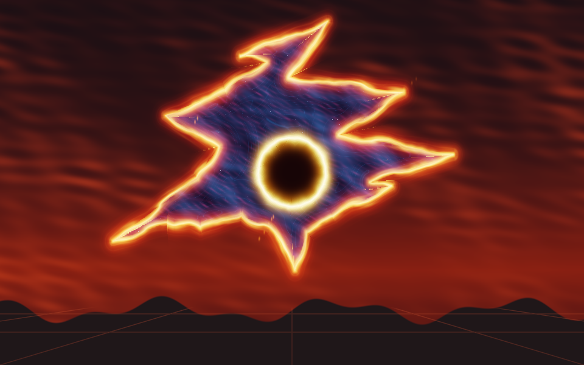
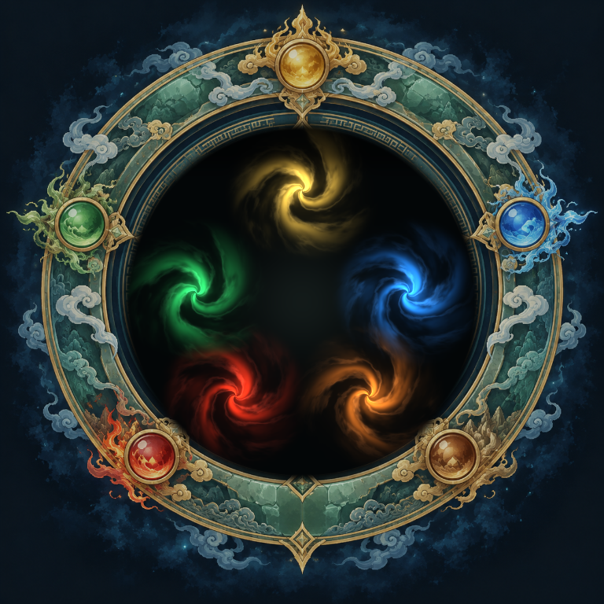
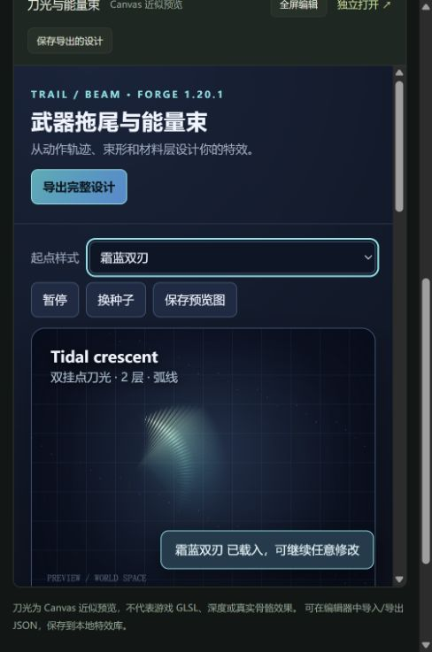
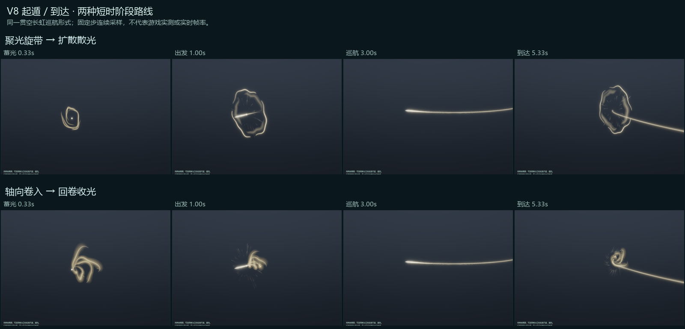
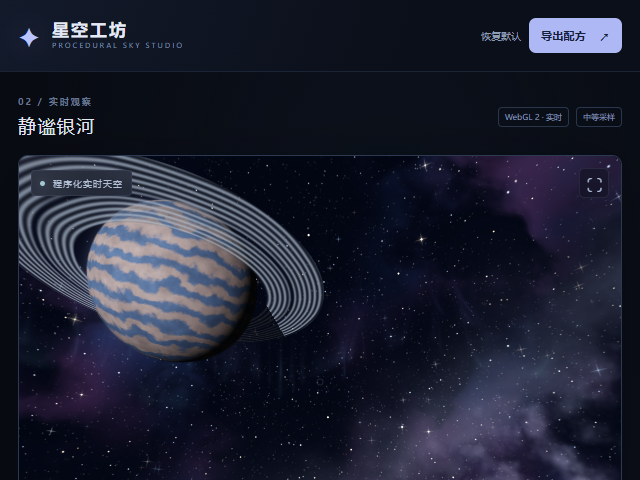
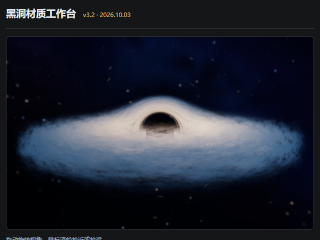
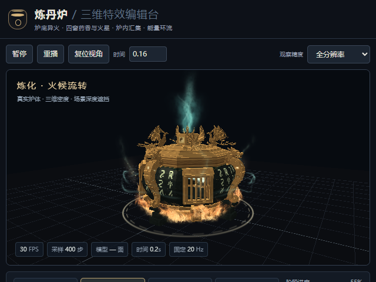
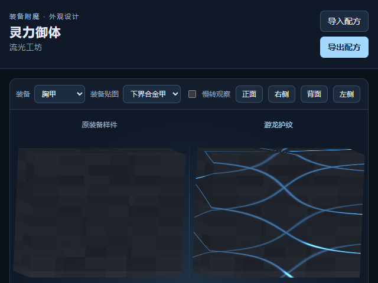

# Minecraft Agent Skills & Rendering Workbenches

Open-source Codex skills, editable rendering workbenches, and Forge 1.20.1 examples for Minecraft developers. The collection connects natural-language effect design, parameter editing, shader integration, and reproducible validation. [English overview](docs/README.en.md).

面向 Minecraft 开发者的 Codex Skills、可编辑渲染工作台和 Forge 示例。当前公开 **26 个渲染相关 Skill、43 个工作台/预览/研究入口**，以及五行仙途中的特效开发与性能优化记录。原有启动器保留；Photon 自动化 Skill 已同步最新工具和版本参考。

- [完整功能、资源、脚本与记录目录](docs/rendering-catalog.md)
- [Skills 安装、调用与特效库使用说明](docs/skills-usage.md)
- [安装与工作台启动](docs/getting-started.md)
- [验证证据与当前限制](docs/validation-and-evidence.md)
- [来源、许可证与发布范围](docs/licensing-and-provenance.md)
- [项目维护与 Codex 使用计划](docs/oss-maintainer-case.md)
- [下载完整源码与 Skills](https://github.com/Roxio-sketch/minecraft-agent-skills/releases/tag/rendering-suite-20261014)

## 独立工作台补齐 · 2026-10-21

[程序化空间裂缝工作台](skills/minecraft-space-rift/assets/space-rift-kit/workbench/index.html) 已随 Skill 分发，包含14个预设和JSON导入导出。动态照明、Bloom、粒子、动画适配、区域表面预览也已放入对应 Skill，闪电补齐 fBm 研究页。统一启动器共45个入口。[启动方式与预览边界](docs/getting-started.md#独立-skill-的工作台2026-10-21)。

## 快速开始

```powershell
git clone https://github.com/Roxio-sketch/minecraft-agent-skills.git
cd minecraft-agent-skills
python .\rendering\启动全部工作台.py
```

Python 3.10+；实时预览主要使用 WebGL2。启动器仅监听 `127.0.0.1`，自动选择空闲端口。输入编号打开工作台，输入 `0` 关闭。普通工作台不需要 API key；Minecraft 接入主要面向 Forge 1.20.1 / Java 17，具体版本和验证范围见各 Skill。

```powershell
$skillsDir = if ($env:CODEX_HOME) { Join-Path $env:CODEX_HOME 'skills' } else { Join-Path $env:USERPROFILE '.codex\skills' }
# 按需安装一个 Skill；目标已有同名目录时先备份。
Copy-Item -LiteralPath .\skills\minecraft-energy-vfx -Destination $skillsDir -Recurse
```

## 仙途特效库 · 2026-10-19

新增[独立特效库技能](skills/minecraft-xiantu-vfx-library/SKILL.md)：九霄剑幕与万剑归宗、金白剑气、五行气海、焚空裂隙，以及灵气、闪电、护盾、拖尾和程序化空间裂隙，共9组。新版裂隙波动沿边缘传播，保持整体尺寸与尖角；代码、必要贴图和配方均可独立复制。

```powershell
python .\skills\minecraft-xiantu-vfx-library\scripts\serve.py
```

全部9组与总览已加入统一启动器。公开副本不包含个人皮肤、商业参考视频或Minecraft原版纹理；浏览器原型不等同游戏战斗版本。[资源与验证范围](skills/minecraft-xiantu-vfx-library/references/provenance.md)。

### 效果预览

以下为当前随包着色器/贴图的离线GPU渲染，以及已有拖尾编辑器截图，均为**效果预览，非Minecraft实机**。不包含商业参考画面。

| 焚空裂隙 · 边缘波动 | 五行气海 | 刀光与能量束 · Canvas近似 |
|---|---|---|
|  |  |  |

操作步骤见[Skills使用说明](docs/skills-usage.md)。截图是单帧，边缘波动、旋涡和拖尾的动态请在工作台中查看。

## 遁光 Skill · V8

新增多形式巡航、起遁与到达的纯程序几何/GLSL研究原型，含视频观察、学习来源、五行仙途两套现有实现索引。保留红黑离烟V3、羽状分叉V3、赤焰V3及后续流光版本。浏览器原型不等于已接入游戏。

- [Skill 与使用说明](skills/minecraft-dunguang-flight/SKILL.md)
- [阶段时序与验证范围](skills/minecraft-dunguang-flight/references/transition-stages-v8.md)
- [离线工作台说明](skills/minecraft-dunguang-flight/assets/prototype/README.md)；统一启动器新增“遁光与飞行阶段”入口



## 工作台截图

以下为 2026-10-14 的浏览器工作台截图，展示编辑/预览界面，不冒充游戏实机画面。

| 天空 | 黑洞 |
|---|---|
|  |  |

| 炼丹炉 | 御体光纹 |
|---|---|
|  |  |

## 渲染与特效 Skills

| 内容 | Skill |
|---|---|
| [多形式遁光与起遁/到达](skills/minecraft-dunguang-flight/SKILL.md) | `minecraft-dunguang-flight` |
| [动态模型与材质挂点](skills/minecraft-animated-material-adapter/SKILL.md) | `minecraft-animated-material-adapter` |
| [程序化空间裂缝](skills/minecraft-space-rift/SKILL.md) | `minecraft-space-rift` |
| [黑洞与白洞](skills/minecraft-black-hole/SKILL.md) | `minecraft-black-hole` |
| [彩色附魔流光与御体护纹](skills/minecraft-colored-glint/SKILL.md) | `minecraft-colored-glint` |
| [物品内部星空与奇幻材质](skills/minecraft-cosmic-material/SKILL.md) | `minecraft-cosmic-material` |
| [天空、大气与天气](skills/minecraft-cosmic-rendering/SKILL.md) | `minecraft-cosmic-rendering` |
| [碎晶折射与色散](skills/minecraft-crystal-refraction/SKILL.md) | `minecraft-crystal-refraction` |
| [动态点光与局部照明](skills/minecraft-dynamic-lighting/SKILL.md) | `minecraft-dynamic-lighting` |
| [三维能量与幽气](skills/minecraft-energy-vfx/SKILL.md) | `minecraft-energy-vfx` |
| [能量算法与源码研究](skills/minecraft-energy-vfx-research/SKILL.md) | `minecraft-energy-vfx-research` |
| [玻璃边缘光](skills/minecraft-glass-rim/SKILL.md) | `minecraft-glass-rim` |
| [Halo 与物品装饰](skills/minecraft-halo-decoration/SKILL.md) | `minecraft-halo-decoration` |
| [原画线稿与屏幕渐变](skills/minecraft-illustration-render/SKILL.md) | `minecraft-illustration-render` |
| [物品内三维场景窗口](skills/minecraft-item-scene-window/SKILL.md) | `minecraft-item-scene-window` |
| [环绕电流与分形落雷](skills/minecraft-lightning/SKILL.md) | `minecraft-lightning` |
| [世界空间区域材质](skills/minecraft-local-environment-material/SKILL.md) | `minecraft-local-environment-material` |
| [局部异空间与二次场景](skills/minecraft-local-subscene/SKILL.md) | `minecraft-local-subscene` |
| [代码驱动粒子](skills/minecraft-procedural-particles/SKILL.md) | `minecraft-procedural-particles` |
| [指定对象 Bloom](skills/minecraft-selective-bloom/SKILL.md) | `minecraft-selective-bloom` |
| [能量护盾与破碎回应](skills/minecraft-stylised-shield/SKILL.md) | `minecraft-stylised-shield` |
| [武器拖尾与能量束](skills/minecraft-trails-beams/SKILL.md) | `minecraft-trails-beams` |
| [体积云雾、黑云与水龙卷](skills/minecraft-volumetric-environment/SKILL.md) | `minecraft-volumetric-environment` |
| [高度场水波](skills/minecraft-water-ripples/SKILL.md) | `minecraft-water-ripples` |
| [体积特效性能优化](skills/minecraft-vfx-performance/SKILL.md) | `minecraft-vfx-performance` |

## 项目专用工作台

异火缠绕：身体/武器附着火流、离体灵火、配方编辑和 Forge 实验后端。炼丹炉：真实炉体模型、炉底火、药气、炼化与成丹阶段、参数编辑和宿主接入补丁。御体护纹：装备表面光流和局部受击设计稿。它们与通用 Skills 一同公开，具体兼容性与完成程度分别记录。

## 验证与维护

本项目区分静态检查、浏览器/GPU 检查、独立 Forge 验证和用户实例验证。历史报告有明确日期和设备；本次发布检查不等于重新运行全部游戏实验。

五行仙途炉底案例记录了 RTX 4060 Ti / 1280×900 下，低分辨率体积积分与深度重建使特定近景底火绘制从约 83–86 ms 降至约 11–11.5 ms；范围是底火 pass，存在细节柔化和后续视觉问题，不能换算为整游戏 FPS。[证据及限制](docs/validation-and-evidence.md)。

欢迎通过 Issue 提交复现、兼容性问题和使用案例；贡献要求见 [CONTRIBUTING.md](CONTRIBUTING.md)。

## AXO 与 MCP-HELPER

[axolotl-launcher](skills/axolotl-launcher/SKILL.md) 发现并启动 AXO 实例；[minecraft-vfx-automation](skills/minecraft-vfx-automation/SKILL.md) 通过 [MCP-HELPER](https://github.com/Roxio-sketch/MCP-HELPER) 与兼容 Photon 构建进行特效自动化。Photon 扩展需实际构建支持。渲染工作台本身不依赖 MCP-HELPER。

## License

原创部分遵循仓库 MIT；第三方代码、贴图和依赖遵循各自许可及版权声明。LGPL RenderBlender 素材、MIT noise/Three.js/Lucide 与 Gradle wrapper 的声明分别保留。[详细来源](docs/licensing-and-provenance.md)。
