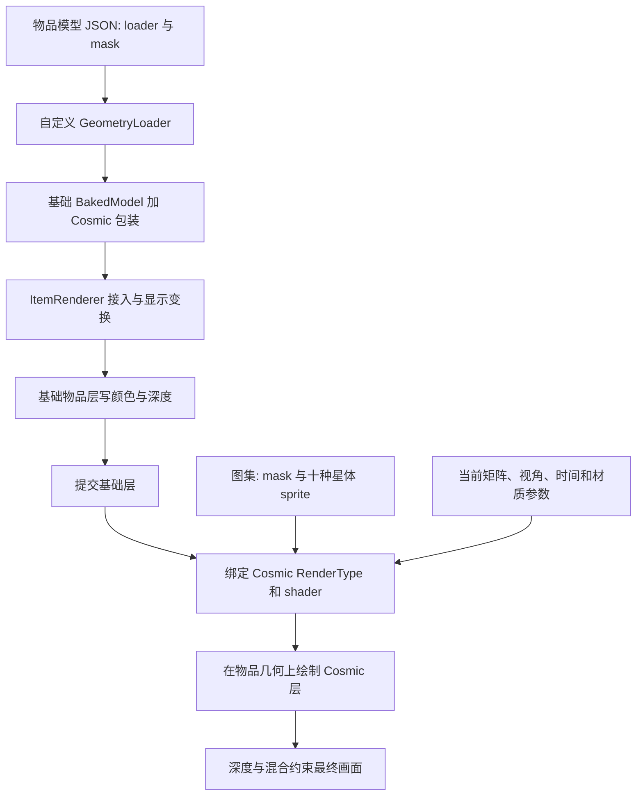

# Avaritia 风格 Cosmic 物品材质研究

研究日期：2026-09-28。范围：用户提供的五份 ZIP，重点是装备和物品上的 Cosmic 材质及其可复用设计方法。五份原项目做了静态研究；后续已新增**独立 Forge 1.20.1 材质实验、启动器实测和已安装 skill 更新**，详见 [运行验收报告](E:/着色器渲染/COSMIC_MATERIAL_RUNTIME_VALIDATION.md)。工作区既有 STARFIELD 天空实验不作为物品验证证据。

## 1. 核心判断

Avaritia 的 Cosmic 是“**物品表面作为窗口，内部按视线方向生成多层宇宙图案**”的材质系统。底层模型保持物品外形和细节，mask 限定 Cosmic 区域，shader 用视线方向、逐层旋转、星体图集和时间生成图案。它不是单张星空图贴在物品上，也不是普通天空渲染；内部仍使用经纬度映射和滚动，不能把它描述成无 UV 或真正体积渲染。[算法证据](research/cosmic-material/evidence-index.md#f-shader)

复现这种风格可行；扩展到广泛物品类别也有明确工程路径。但五个参考项目都不足以证明一个现成 loader 能覆盖所有物品。尤其现有 mask 几何由二维 sprite 挤出生成，三维模型、动态物品和穿戴装备必须有相应适配器。通用目标应是**材质算法可复用、几何入口可扩展、每类物品可验收**。[模型证据](research/cosmic-material/evidence-index.md#f-wrapper)

## 2. 五个项目各自提供什么

| 项目 | 本次快照平台 | 研究价值与限制 |
|---|---|---|
| 1.18.2 Cosmic_and_Halo Renderer | 文件名为 1.18.2，Forge 旧模型 API；没有完整 Gradle 工程 | 提供 CCL 的早期 Cosmic/Halo 链路，GUI scale=25；不能当作已验证构建模板 |
| Re-Avaritia Forge | 1.20.1 / Forge 47.4.20 / Java 17 | 主研究基线；包含模型、shader、atlas、物品、护甲、Halo |
| Re-Avaritia Neo | 1.21.1 / NeoForge 21.1.215 / Java 21 | 算法沿用，增加/改变绘制格式、深度和 Iris 延迟路径；有静态格式不一致 |
| Avaritia-Render | 缺构建配置和资源 | 作者 README 明示未实测；只能作为代码片段线索 |
| RenderBlender | 1.20.1 / Forge 47.4.13 / Java 17 | 展示把渲染抽成库的路线；注册回调和时间源仍需修整 |

ZIP 共包含 **4,285 个文件**（不含目录项）。原包哈希、逐文件哈希、shader diff、贴图分析均已保存；没有使用分支名冒充提交版本。详见 [归档清单](research/cosmic-material/archive-manifest.json)、[逐文件清单](research/cosmic-material/source-inventory.json)、[证据索引](research/cosmic-material/evidence-index.md)。许可文件与片段完整性也已记录在 [skill 来源说明](skill/minecraft-cosmic-material/references/sources.md)。

## 3. 完整渲染链路



Forge 快照通过 ModelEvent 注册 loader，通过 RegisterShadersEvent 注册 shader；Mixin 识别 PerspectiveModel，实际调用 renderItem。JSON 指定 `loader` 只是起点。`isCustomRenderer=true` 也不是充分实现，它必须与具体 renderer 入口配合。相关官方机制见 [Forge 模型加载器](https://docs.minecraftforge.net/en/1.20.x/rendering/modelloaders/) 与 [BEWLR](https://docs.minecraftforge.net/en/1.20.x/items/bewlr/)。

纹理来自 block atlas。`src/generated/resources/assets/minecraft/atlases/blocks.json` 把 misc、models、mask 纳入；TextureStitchEvent.Post 获取各 sprite 的 UV 矩形。资源重载后矩形可能改变，不能硬编码 UV。ShaderInstance 注册回调也会替换实例和 uniform。[注册与图集证据](research/cosmic-material/evidence-index.md#f-register)

## 4. 星空为何不像普通贴图

片元中先取 `normalize(-fPos)`，按 pitch 和 -yaw 调整，再为 16 个层分别旋转方向、计算经纬度、缩放和滚动。每层用 16×16 网格和 hash，从 101 个槽选取 10 种 sprite 或空白，再旋转/翻转图标。不同层的尺度与亮度共同产生深度错觉；真实几何仍在物品表面，没有射线穿越有限星云体积。

这里有两套坐标：**模型 UV 采 mask；方向坐标决定星体分布**。换个物品形状不会强迫宇宙图案跟着原纹理拉伸，这是可复用材质的关键。通用实现可在此基础上设计世界方向固定、物体局部、屏幕固定等模式，但参考的玩家 yaw/pitch 并不天然覆盖第三人称实际相机和所有 MOD 视角。

几个决定复现结果的细节：

- **10 张星体图不等于 10 层**：源码是 10 sprite、16 层、101 槽位。
- mask 读 **红通道**；星体强度同样读红通道。纯透明白底图可能把隐藏 RGB 采成亮矩形。
- 星体颜色由程序计算，不能只换彩色 PNG 就得到彩色星云。
- shader 内弱光照混合不等于实际照亮周围方块，也不等于 bloom。
- `col` 的 alpha 随星体一起累加，因此灰阶 mask/opacity 并非严格线性覆盖。
- GUI scale：旧示例 25，Re/RenderBlender 100；是投影观感补偿的实现选择，不是通用物理参数。

完整公式、40-float 图集矩阵顺序、时间单位和改良取舍见 [算法与参数契约](skill/minecraft-cosmic-material/references/algorithm.md)。

下面只展示原始素材首帧，用于辨认 sprite 和 mask；**不是游戏效果截图**。十张星体图均为不透明灰阶动画条；无尽剑 mask 也是不透明灰阶动画图，基础 layer 则另有透明轮廓。[贴图测量](research/cosmic-material/texture-analysis.json)


## 5. “所有物品”需要解决的实际问题

| 类别 | 可复用内容 | 必须补上的适配 |
|---|---|---|
| 普通二维物品 | 原 Cosmic 核心与 mask loader | 保留原 display、tint、overrides、glint，校验 mask 与底层深度 |
| 三维方块物品/复杂模型 | 相同方向场和配色 | 重放原 quads，按原 sprite 局部 UV 映射到 mask，不能再造二维剑壳 |
| 弓弩、钟、罗盘等状态物品 | 材质与选择规则 | 包装本帧最终模型，覆盖所有动作和状态 |
| 箱子、盾牌、三叉戟及其他动态 renderer | 核心 shader | 对 ModelPart/VertexConsumer 或原 renderer 增加材质层 |
| 骨骼动画物品 | 材质算法 | 对应动画框架的层/材质 hook，保持骨骼矩阵 |
| 穿戴护甲 | shader 算法、atlas | 单独的模型/armor layer、格式与 sprite.wrap；物品栏图标不等于穿戴模型 |
| 半透明/多 pass 物品 | 配色与图案 | 单 pass 融合或专用 coverage/depth/排序策略 |

“普通二维”并不意味着所有现有工具能直接套接口：原版剑无法通过 JSON 实现 Java 的 IToolTransform。已有 custom loader 也不能直接覆盖成 cosmic，否则原几何来源可能丢失。更合适的通用系统是在原模型完成解析后包装它，或为动态 renderer 增加 adapter。

建议架构为 `物品/状态匹配 → 材质定义 → 几何适配器 → 捕获当前参数的 draw packet → 材质绘制器`。支持范围按适配器扩展；没有入口的特殊物品保留原样并报告，不静默破坏其外观。详细步骤及 UV 换算见 [接入方案](skill/minecraft-cosmic-material/references/integration.md)。后续 [Cosmic Material Lab](E:/着色器渲染/cosmic-material-lab/README.md) 已实现并实测 baked-item 单 pass、原版式穿戴防具和原版盾牌适配器，含保留金属边框预设；见 [装备运行验收](E:/着色器渲染/COSMIC_EQUIPMENT_RUNTIME_VALIDATION.md)。其他动态物品、骨骼装备和全类别兼容仍未完成。

## 6. 移植风险：不能只复制 GLSL

F/N 主 `cosmic.fsh` 逐字节相同，B 只有注释拼写差异，L 的主要算法差异为 hash 常量。[实际差异](research/cosmic-material/shader-diffs.txt)

但绘制状态不同：Forge 物品采用 BLOCK 顶点格式和 EQUAL 深度；Neo COSMIC RenderType 改为 NEW_ENTITY、LEQUAL、仅写颜色并带 polygon offset。Neo ShaderInstance 注册却仍为 BLOCK，形成**可定位的静态格式不一致**。必须在移植时统一三者：shader 注册、RenderType、实际顶点输出；此报告不把静态发现表述成已复现的运行故障。[Neo 格式证据](research/cosmic-material/evidence-index.md#n-format)

RenderBlender 同一回调被物品与护甲 shader 注册复用，两次都赋值 COSMIC_SHADER 及同一组 uniform，存在实例归属冲突；它的模型层写时间后，onApply 又会重写时间。复制库时应分别管理实例、明确唯一时间源。[RenderBlender 证据](research/cosmic-material/evidence-index.md#b-shaders)

共享 uniform 也不会自动随 MultiBufferSource 中的顶点保存。如果 A、B 两个物品使用不同 opacity/palette，却到最后才提交同一 shader 批次，可能串用参数。方案是受控地提交每个 draw、按材质状态分组，或把变化参数放到顶点/实例数据中；不能只看 uniform.set 写在“该物品的函数里”。

Neo Iris 路径只对第一/第三人称手持启用延迟队列，在 AFTER_LEVEL 重放；它复制矩阵，但没有完整捕获所有 GPU 输出状态，也没有 finally 异常清理。第一人称 enqueue 与 drain 的实际帧顺序、framebuffer、深度附件仍需运行验证。此快照不能作为全部 Iris/Oculus/光影包兼容证明。[队列证据](research/cosmic-material/evidence-index.md#n-queue)

## 7. 任意设计如何落地

把设计分为覆盖区域、空间锚定、图案、层、颜色、动态、合成与预算八个维度。mask 决定哪里出现；sprite/程序场决定出现什么；方向和层参数决定空间观感；adapter 决定如何贴合目标物品。Halo 单独控制，不必和 Cosmic 绑定。

例如紫蓝无尽剑可保持原核心，仅改变 blade mask 和程序 palette；金色符文书可改 sprite 与旋转规则；红黑星云三维斧需要原模型 quads 适配，并新增低频噪声场。现有 JSON 没有 `palette`、`layerCount` 等任意设计接口，这些要在实际工程中实现，不能写入 JSON 后声称已经生效。[设计方法与三个示例](skill/minecraft-cosmic-material/references/design.md)

## 8. 交付与验证范围

新增技能：`minecraft-cosmic-material`。维护副本在 [项目 SKILL.md](skill/minecraft-cosmic-material/SKILL.md)，安装副本在 [个人技能目录](C:/Users/MAINTAINER/.codex/skills/minecraft-cosmic-material/SKILL.md)。不替换既有天空渲染 skill。

可直接使用：

```text
使用 $minecraft-cosmic-material，为 Forge 1.20.1 的普通物品和三维斧设计紫蓝 Cosmic 材质。
保留原模型、动作和附魔效果，先分类渲染入口，再实现并验证 GUI、双手持握、掉落和展示框。
```

已完成五包来源分析、shader 比较、PNG 通道/动画检查、技能文档和来源索引。技能结构、链接与安装一致性结果见 [静态验证记录](research/cosmic-material/validation.json)。独立实验的生产构建、10 个游戏场景和证据检查见 [运行验收报告](E:/着色器渲染/COSMIC_MATERIAL_RUNTIME_VALIDATION.md)。原始参考项目仍未编译，不承诺全物品覆盖或光影兼容；后续依 [验收矩阵](skill/minecraft-cosmic-material/references/validation.md) 按适配器逐类扩展。
