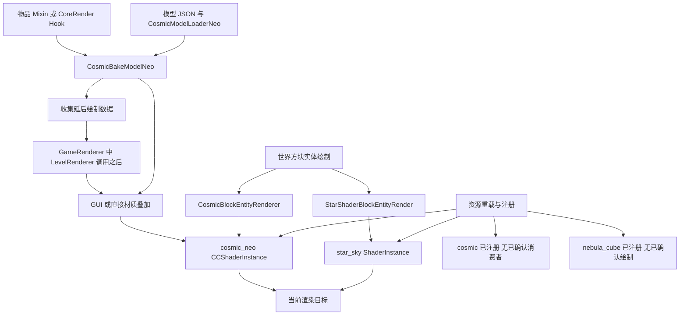

# Minecraft 星空与宇宙渲染实现研究

研究日期：2026-09-28。参考版本：ArcaneVortex 0.6.8 Alpha，Minecraft 1.20.1 / Forge 47 系列。阶段：知识研究；不创建正式 skill，不编写新效果，不修改模组源码。

**核心结论：这份参考不是一套已经完整接入维度天空的星空系统。** 五组目标资源包含未找到调用的实验着色器、方块表面的分形宇宙、模型遮罩中的动态图集星空，以及尚未找到 Java 绘制入口的体积合成着色器。最完整的可追踪链路是 `star_sky` 方块和 `cosmic_neo` 物品/方块；不能将它们直接描述为世界背景天空。

本报告的“已确认”指资源、代码或字节码证据确认。未启动 Minecraft，未进行 GLSL 驱动编译、GPU 抓帧、视觉比较或性能实测；静态接入证据不等于画面已经运行验证。

## 1. 研究范围与资料来源

用户确认本轮只完成研究文档，skill 留到下一阶段。《第一步.txt》用作阶段范围参考；材料中的其他命令没有被自动当作操作授权。

主要资料：

| 来源 | 用途 | SHA-256 |
|---|---|---|
| `C:/Users/MAINTAINER/Desktop/五行/渲染/着色器包/秘法涡流-全部着色器与渲染代码完整拆解.txt` | 主要阅读来源；包含 GLSL 与 CFR 反编译 Java | `CAFC455E05C917DA6C2CF53878EC5C3428640B74AE390C53414B4C3D903C1BA9` |
| 同目录 `ArcaneVortex [Alpha]-0.6.8-1.20.1-Forge.jar` | 资源核验、成员引用搜索、遗漏类定向补充 | `27C5D799A488A418A588B978BB77DA6BD48BBE48D8BC5C6A11CFB7B6F60A8B97` |
| 本机 ForgeGradle 缓存的 `1.20.1-47.4.10_mapped_official_1.20.1` | 核对 `ShaderInstance`、`Uniform`、`VertexBuffer` 行为；不是对用户运行环境的版本认定 | 见下述平台证据路径 |
| 本机 `mapping-1.20.1-mapping.zip` | 将关键 SRG 字段还原为语义名称 | 摘录保存于 `research/evidence/platform-mapping-excerpt.csv` |

JAR 的 `META-INF/mods.toml` 声明 Forge `[47,)`、Minecraft `[1.20.1,1.21)`，Mixin 声明 `JAVA_17`。本报告按文件标称 1.20.1 研究，不推定声明范围内每个版本都可用。

五组 `.vsh/.fsh/.json` 共 **15 个文件**已与 TXT 比较；忽略换行及首尾空白后全部一致。TXT 的 `cosmic_neo.fsh` 和 `nebula_cube.vsh` 将结束代码围栏紧接在 `}` 后，初次提取产生假差异，修正围栏解析后消失。结果见 [shader-checks.json](research/evidence/shader-checks.json)。

证据目录和简写：

| 简写 | 本地证据 | TXT 起始代码行 / 关键定位 |
|---|---|---|
| SF | [starfield.fsh](research/evidence/shaders/starfield.fsh)、同名 vsh/json | fsh 3948；vsh 3926；json 4605 |
| SS | [star_sky.fsh](research/evidence/shaders/star_sky.fsh)、同名 vsh/json | fsh 4666；vsh 4641；json 4796 |
| CO | [cosmic.fsh](research/evidence/shaders/cosmic.fsh)、同名 vsh/json | fsh 1917；vsh 1884；json 3032 |
| CN | [cosmic_neo.fsh](research/evidence/shaders/cosmic_neo.fsh)、同名 vsh/json | fsh 3108；vsh 3075；json 3881 |
| NC | [nebula_cube.fsh](research/evidence/shaders/nebula_cube.fsh)、同名 vsh/json | fsh 5141；vsh 5124；json 5506 |
| J | [TXT Java 提取索引](research/evidence/txt-index.json)，文件在 `research/evidence/java/` | ModShaders、ModRenderType、CCShaderInstance、CCUniform、Neo 模型系统、相关 Mixin 等 |
| JB | `research/evidence/jar-java/com/erchien/arcanevortex/` | JAR 定向补充的 AvaritiaClient、ModRender、Helper、TimeSystem、RenderStateSnapshot、CoreRender 等 |
| P | `research/evidence/platform-java/` | 本机 Forge 1.20.1 平台类定向反编译 |

只沿直接相关调用补充资料；没有完整反编译 MOD。对全 JAR 扫描的是文件名、目标字符串和 class 常量池成员引用，不是全量代码阅读。定向反编译使用 [CFR 官方 0.152](https://www.benf.org/other/cfr/)，下载文件 MD5 与官方页面给出的值一致；其输出仍可能存在反编译语义误差。

成员引用工具 [ClassReferences.java](research/tools/ClassReferences.java) 仅解析 class 文件，不加载或执行 MOD。结果见 [member-references.tsv](research/evidence/member-references.tsv)。常量池命中是候选引用，结合对应函数体才确认实际调用；没有命中也不排除外部 MOD、反射或运行时变换。校验清单与数值例子的结果保存在 [audit-manifest.json](research/evidence/audit-manifest.json)。

下文标记：**实现事实**＝可定位的代码行为；**通用方法**＝可迁移的数学/工程原则；**静态风险**＝代码可推出的问题，未宣称在本机运行复现；**未确认**＝缺少必要证据。

## 2. ArcaneVortex 星空渲染总体架构

| 资源 | 注册 | 已找到的绘制入口 | 实际归类 |
|---|---|---|---|
| `starfield` | 未找到；class 字符串扫描无 `starfield` 命中 | 未找到 | 算法与资源案例；不能视为已接入 |
| `star_sky` | `ModShaders.registerShaders`，POSITION_COLOR_NORMAL | `StarShaderBlockEntityRender.render` | 世界方块实体六面几何上的程序化分形 |
| `cosmic` | `ModShaders.registerShaders`，POSITION_COLOR_NORMAL | 未找到该 ShaderInstance 的外部使用者 | 已注册的旧版/备用资源；状态用途是推测 |
| `cosmic_neo` | `AvaritiaClient.onRegisterShaders → AvaritiaShadersNeo.onRegisterShaders`，BLOCK | `CosmicBakeModelNeo`、`CosmicBlockEntityRenderer`、部分实体/几何 RenderType | 模型/方块材质与特效几何；非统一维度天空 |
| `nebula_cube` | `ModShaders.registerShaders`，POSITION | 未找到 getter 调用或外部字段使用 | 全屏体积合成的 GLSL 设计，Java 接入链缺失 |

重要的同名陷阱：`ModShaders.getCosmicShader()` 返回 `cosmic`；`AvaritiaShadersNeo.getCosmicShader()` 返回 `cosmic_neo`。`ModRenderType.cosmic` 和 `LightSpikeRenderer` 引用的是后者。已解析 owner 的成员引用中，前者没有外部调用，`ModShaders.cosmic_shader` 也仅在 `ModShaders` 自身被引用。

`SkyboxRenderer` 确有移除平移的天空几何代码，但选择的是 **chaos**；其 `SkyboxEventHandler` 两个 `AFTER_SKY` 分支均为空，未发现 `renderSkybox` 的成员调用。它不能补齐这五个目标 Shader 的天空调用链。

## 3. 完整渲染调用链

### 3.1 star_sky：可追踪到世界方块实体

```text
MOD 总线 EntityRenderersEvent.RegisterRenderers
  → ModRender.registerBlockEntityRenderers
  → star_shader_block ↦ StarShaderBlockEntityRender

Minecraft 世界方块实体绘制
  → StarShaderBlockEntityRender.render
  → 获取 ModShaders.getStarSkyShader；写 time / screenSize / yaw / pitch 等
  → renderCosmicCube → ModRenderType.builder(...)
  → 六个面，每面两组三角形，36 个顶点
  → MultiBufferSource 获取 VertexConsumer，提交 POSITION_COLOR_NORMAL
  → 批次实际绘制时应用 ShaderInstance / 矩阵 / RenderType
  → star_sky.vsh 投影几何
  → star_sky.fsh 从片元投影位置构造观察方向并积累分形
  → 当前渲染目标；几何深度参与遮挡
```

入口不是 `AFTER_SKY`，也不是维度 `renderSky`。片元计算可能“看起来是远方宇宙”，但可见区域仍由世界中的一米方块六面限制。没有场景颜色或场景深度纹理输入，没有自建 framebuffer 的证据。

定位：JB `Content/ModRender.java::registerBlockEntityRenderers`；J `StarShaderBlockEntityRender.java:render/renderCosmicCube/renderQuad/addVertex`；SS vsh `main`、fsh `main`。

### 3.2 cosmic_neo：模型装配、物品拦截和叠加

```text
MOD 总线
  → AvaritiaClient.registerLoaders
  → 注册 cosmic_neo 几何加载器
模型 JSON loader = arcanevortex:cosmic_neo
  → CosmicModelLoaderNeo.read
  → 解析 cosmic_neo.mask（单张或数组）并剥离扩展字段
  → CosmicGeometry.bake → 原始 BakedModel + CosmicBakeModelNeo 包装

物品绘制入口（Mixin 或 CoreRender 注入，取决于运行时）
  → handleCameraTransforms → 平移 (-0.5,-0.5,-0.5)
  → renderItem / renderGuiItem，或 collectData 延后绘制
  → 原模型 render passes / RenderTypes
  → renderCosmicEffect：先 flush，写本次参数和图集 UV
  → COSMIC_RENDER_TYPE：BLOCK / QUADS / EQUAL_DEPTH_TEST / 图集
  → 按 mask sprite 烘焙覆盖几何
  → cosmic_neo.vsh → fPos / texCoord0
  → cosmic_neo.fsh → 背景 + 星点 + mask.r × opacity + fog
```

`models/item/van_sh.json` 是已核对的模型样例；mask 是 `item/van_sh/mask/van_sh_mask_n2`。`models/block/cosmic_block.json` 也使用该 loader，遮罩为 `block/white`。模型 UV 用于定位遮罩；宇宙主体常由观察方向驱动，两者不是同一套 UV。

定位：JB `CosmicRender/AvaritiaClient.java:31–37`；J `CosmicModelLoaderNeo.java::read/bake`、`CosmicBakeModelNeo.java::renderCosmicEffect/renderRegularItemCosmic/renderBlockItemCosmic`；J `ItemRendererMixin.java::renderItem`。

### 3.3 cosmic_neo：方块与其他几何

```text
ModRender.registerBlockEntityRenderers → cosmic_block renderer
  → CosmicBlockEntityRenderer.render
  → CosmicBlockData 的 type / scale / color
  → createCosmicRenderTypeForBlock 的 ShaderState supplier 设置参数
  → 六面 BakedQuad + block/white atlas sprite
  → cosmic_neo
```

这是另一条真实调用链；不要因类名 `CosmicBlockEntityRenderer` 将它归到旧 `cosmic`。该方块工厂与物品的 EQUAL_DEPTH_TEST RenderType 也不同，不应混用状态结论。

另有 `LightSpikeRenderer.renderLightSpike(useType=1)`：`ModShaders.setCosmicShader(...,16,...) → AvaritiaShadersNeo::getCosmicShader → position_color_shader_no_cull_c`。这里只研究它作为 Neo 的真实调用者，不展开武器效果。

### 3.4 延后绘制分支及 CoreRender 入口

`GameRendererMixin.afterRenderLevel` 注入于 `GameRenderer.renderLevel` 中调用 `LevelRenderer.renderLevel(...)` **之后**，不等价于整个游戏帧末尾。它在 `Helper.isShaderPackActive() != null` 时调用 `CosmicBakeModelNeo.renderAllPendingItems`。

队列保存 ItemStack、展示上下文、PoseStack 矩阵及 `RenderStateSnapshot`；稍后恢复状态并 `renderItemDirect`。普通上下文先绘制，第一人称随后绘制，并在每件第一人称物品前 `RenderSystem.clear(256,...)`，即清深度缓冲。清除的是当时绑定目标的深度；目标归属未在此函数中证明。

补充的 `Core/CoreRender/RenderPlugin` 向 `ItemRenderer.m_115143_` 头部插入 `ItemRenderHelper.renderItem`，返回 true 时提前返回。`ItemRenderHelper` 设置 `Helper.coreMod=true`，Mixin 在 `!Helper.coreMod` 时接管，二者是替代入口。Core helper 在 `!Helper.mixin` 时仍可直接绘制；因此不能把“所有运行环境都必定延后绘制”当作结论。

**静态风险：** `Helper.isShaderPackActive()` 检测 Iris API，缺少类时返回 false，异常时返回 true，没有返回 null 的分支。Mixin 的 `== null` 直接路径因此不可达；其 `!= null` 队列提交条件始终成立。Core helper 的其他条件仍可能影响路径。实际插件加载及各 hook 的执行先后没有运行验证。

### 3.5 三条没有闭合的链

- SF：有算法和 JSON，但没有找到注册、uniform 提交或 draw。
- CO：有注册，但没有找到消费者；`setCosmicShader` 实际写的是 Neo uniforms。
- NC：有注册，GLSL 要求深度/颜色/矩阵，但没有找到 sampler 绑定、相机值上传或全屏绘制。仅凭 `MainDepthSampler` 名称不能补出 `DepthBufferManager` 调用。

上述边界以整个提供 JAR 的目标字符串及成员引用搜索为依据；不排除动态或外部调用，统一标为“参考实现中未能确认”。

## 4. 坐标空间与相机系统

### 4.1 先辨明输入空间，再看变量名

| 名称 | 代码实际含义 | 容易误读之处 |
|---|---|---|
| SF `worldPos/fragPos` | 直接赋 `Position` | 未找到 Java 提交者，不能证明是绝对 world space |
| SS `worldPos` | 直接赋 `Position`；Java 先用 pose 变换局部顶点 | 名字不能证明绝对世界位置 |
| SS `viewPos` | `ModelViewMat * Position`，fsh 未用它输出效果 | 有 varying 不等于功能使用 |
| CO/CN `fPos` | `ModelViewMat * Position` 的 xyz | 是按提交矩阵所得视相关位置；已包含 Java pose 的影响 |
| NC `texCoord` | clip-space 全屏 Position.xy 映射到 [0,1] | 不是模型遮罩 UV |
| NC `cameraPos/entityPos` | 算法按世界位置解释 | Java 值来源未找到 |

Java 的 `VertexConsumer.vertex(pose,...)` 已变换顶点，Shader 再乘 `ModelViewMat`。分析时应写出完整乘法链，不能给 `Position` 擅自贴上“模型局部”或“世界绝对”标签。

### 4.2 为什么理想天空没有平移视差

**通用方法：** 无限远天空的颜色是世界观察方向 `C(d_world,t)`，不依赖相机世界位置。常见两种实现：以相机为中心的天空几何，只保留观察旋转；或者用全屏片元经逆投影得到视空间射线，再用逆观察旋转变成世界方向。世界中的有限体积星云则应依赖相机位置，平移产生视差是正确行为。

示意公式，假设通常 OpenGL 透视与深度约定：

```text
q_clip = (2u-1, 2v-1, z_ndc, 1)
q_view = inverse(P) * q_clip；再除以 q_view.w
d_view = normalize(q_view.xyz)
d_world = normalize(inverse(R_view) * d_view)
sky = C(d_world, time)
```

这是通用设计推导，不是本 JAR 已完整采用的天空实现。逆矩阵应与本次实际投影一致；正交相机需要另行处理射线起点。

### 4.3 参考实现的实际做法

- SF 用 `normalize(-fragPos)`，再可选按 `-CameraPitch/-CameraYaw` 旋转；没有 camera position 或逆投影恢复。没有 Java 入口，无法证明它保持平移不变。
- SS 在 fsh 重新投影插值位置，得到 `ndc=clip.xy/clip.w`，取 `uv=ndc*0.5`，按宽高比缩放 x，再用 `vec3(displayUV*0.8+iZoom,1)` 构造方向。之后 pitch、yaw 旋转，再加随时间变化的两个轴向旋转。这是屏幕方向场裁切到方块表面，不是以真实 FOV 逆投影恢复方向。
- SS Java 上传角度是 `degrees*PI/360`，只有通常度→弧度的一半。源码证明了该比例；它是否是作者有意的视觉设计未确认。它不适合作为视角一比一对齐范例。
- CO/CN 大多数星点从 `normalize(-fPos)` 出发，再使用 pitch 和负 yaw。CN Java 大多数入口使用**玩家角度**而非 `Camera`，且没有在这些函数里插值；第三人称、独立相机、相机滚转不保证对齐。
- CN type 14 的主要银河纹理来自 `gl_FragCoord.xy`，转头方向只调制部分亮度；它确实包含屏幕固定成分。type 15 自己构造带宽高比的射线，仍未使用实际投影 FOV。
- NC 使用 `inverse(projectionMatrix)` 与 `inverse(modelViewMatrix)` 恢复世界位置/方向，是五组中明确采用逆矩阵重建的算法，但接入未闭合。

NC `viewToWorld` 在逆 model-view 后**又加 cameraPos**，因此它期待该矩阵作用于 camera-relative 坐标。若上传含完整世界相机平移的 view matrix，会重复加入相机平移。该数据契约必须在未来实现中明确。

### 4.4 如何避免屏幕贴图感

通用建议：将主体噪声与星点定义在球面方向或三维方向域；用实际相机旋转及投影；模型 UV 只负责遮罩；只在有意设计的闪光/屏幕扰动上使用 `gl_FragCoord`。对比固定时间下的平移、转头、变 FOV、改变窗口比例，分离设计动画和坐标错误。

## 5. Starfield 实现原理

算法定位：SF `sphereUV`（26）、`safenoise`（41）、`bigStarColor`（176）、`galaxyDensity`（251）、`starField`（446）、`main`（570）；括号为提取后的文件行号。

### 5.1 小星点：球面分块、确定性随机和阈值

`sphereUV` 用 atan(z,x) 和 acos(y) 生成经纬 UV；`starField` 将它乘以密度尺度，`floor` 得到格子 id，`fract-0.5` 得格内位置。`safenoise` 是正弦 hash 支持的二维值噪声；在整数格点上就退化为该格子的确定性 hash。没有来自世界种子的独立 seed uniform。

密度坐标尺度是：`200 / scale * MaxStarCount * (1 + galaxyMult + clusterMult)`。`MaxStarCount` 不是直接循环生成的星数；提高它主要提高空间频率、密度及混叠风险，不能把它与大星星的 `StarCount` 混为一谈。

每格通过随机阈值决定是否产生星点，中心加入随机 offset，半径使用 `starSize*0.08/scale`。`1-smoothstep` 与幂函数组成星盘/亮核，亮度乘正弦闪烁。部分星点会摆动、出现伴星或脉动。

### 5.2 大星点：逐星循环

`bigStarColor` 将 `StarCount` 按 `StarMask` 层分配，每像素遍历该层星星；随机位置、颜色和半径由 starId 的 hash 决定。大星半径为 `0.008*StarMScale*(0.7+hash*0.6)`。运动有圆形、8 字形和双正弦三种选择。

`StarMSpeed` 在 `bigStarMovement` 中最终乘的是运动位移，函数的角时间项没有乘它；名称叫 speed 但实际改变了振幅，不能把字段名直接当参数语义。星星颜色有冷白、暖白、红橙、橙和紫色分组，是该 MOD 的美术选择。

整数分层丢余数：默认 `StarCount=20`、`StarMask=3` 时 `starsPerLayer=6`，实际访问 18 个大星索引。每层另有 `i<200` 限制，主层循环最多 10 层。这些不应照搬成通用计数方案。

### 5.3 银河与层次

`galaxyDensity` 用 `exp(-abs(dir.y)*8)*2` 形成赤道带，加双臂正弦项；6 个局部星团和 3 个高级团簇进一步改变密度。`galaxyGlow` 使用紫色低亮度底色及 4 octave FBM；高级模式还调用超新星、虫洞、脉冲束和彗星函数，本轮只记录它们是额外每像素成本，不扩展研究这些系统。

普通模式 8 层，高级模式 12 层；各层通过固定 hash 导出的旋转降低重叠规则感，再按 `layerDepth` 调亮度。这里的“深度”主要是视觉分层，不是给星星建立真实世界三维位置或真实距离遮挡。

### 5.4 可用知识与不宜照搬之处

可复用：确定性格子 hash、阈值分布、亮核轮廓、分层方向旋转、银河带密度调制、独立大星点参数。

静态风险：

- `starField` 返回标量；最终小星颜色又按“层号”生成，并非逐格返回各星自己的完整 RGB。不能声称所有小星都按 `getStarProperties` 的格内颜色输出。
- `boundaryAwareDistance` 只处理经度横向 wrap；经纬 UV 仍有极区面积畸变，也不能保证所有噪声/网格在经度接缝连续。
- 让密度直接改变 UV 尺度会移动格子边界；`galaxyDensity` 本身含时间，密度动画可能使星点重排，而非只改变亮度。
- `StarScale` 同时进入密度、星体属性和半径公式，非简单“半径倍率”。零值还会造成除零。
- `bigStarSystem` 是另一套计算，但 main 调用的是 `bigStarColor`；不要把未调用函数也计入实际 GPU 成本。
- JSON 中 `Opacity` 和 `ColorModulator` 没有对应活动输出逻辑；最终 alpha 是 `Sampler0` 遮罩红通道。默认 `Opacity=0` 不代表这份 fsh 的输出必定透明。

## 6. Star Sky 实现原理

SS 不是离散 hash 星点系统，而是沿射线累加反复空间折叠的分形体积外观。

`main` 在每个采样点先做平铺折叠，再反复执行 `p=abs(p)/dot(p,p)-0.53`，累计相邻长度变化 `a`。每个外层样点贡献背景与按距离幂次着色的亮度；dark matter 项和 `distfading` 衰减改变空洞及远处亮度。

| 通用概念 | ArcaneVortex 参数 |
|---|---|
| 射线采样数 × 分形迭代数 | `volsteps=20` × `iterations=17`，约 340 次内层折叠/片元 |
| 步进与视域 | `stepsize=0.1`、`zoom=0.8` |
| 折叠/平铺外观 | `formuparam=0.53`、`tile=0.85` |
| 发光与衰减 | `brightness=0.0015`、`distfading=0.73`、`saturation=0.85` |
| 运动 | `time*0.01+0.25`，from 平移和两次轴向旋转 |

它没有外部纹理、星数 seed、单星半径或显式星颜色列表。“星点”是分形亮点；不能把 SF 的 hash/StarCount 解释套到 SS。

输出 `finalColor=v*0.01`，alpha=`max(0.5,length(finalColor))`。SS JSON 指定 RGB 加法混合 `srcalpha, one`，RenderType 却指定 NO_TRANSPARENCY。平台 `ShaderInstance.apply` 又应用 JSON blend，因此不能只看其中一处就宣布最终合成状态；标准调用顺序下 JSON 配置后应用，实际 GL 缓存/其他模组干预需要抓帧验证。

`cameraPos` 被 Java 写入，但 SS JSON 叫 `cameraPosition`；fsh 声明 `cameraPos` 却没有使用。已核实 Java 用的是 `safeGetUniform`，缺失时返回 dummy，不应误报此处必然空指针。正确结论是该值没有构成相机平移控制。`IViewRotMat`、vertexColor、viewPos 也不驱动最终效果。

主要风险：半角旋转、固定 zoom 与实际 FOV 不一致、分形除数 dot(p,p) 未设 epsilon、每像素高迭代成本、加法混合与深度写入策略需要统一。视觉是否出现黑斑/漂移：未运行确认。

## 7. Cosmic 实现原理

CO `main` 中，默认星空分支从 `normalize(-fPos)` 得到方向，使用 yaw/pitch 旋转，然后在 16 层中：

1. 固定层索引生成旋转轴与角度。
2. 将旋转射线投到经纬 UV。
3. 按层级和 `externalScale` 缩放 UV，并让 v 随 time 缓慢移动。
4. 以 16×16 分块规则生成 symbol；`symbol<10` 才绘制。
5. 用 `cosmicuvs[10]` 选择图集内的星形 sprite，局部 UV 可旋转/翻转。
6. 将纹理红通道当亮度，乘层权重和极区衰减，叠加后乘模型遮罩与 opacity。

因此这是 **程序化分布 + 外部二维动画星形图集 + 模型遮罩**，不是 cubemap，也不是纯程序化生成所有星形。纹理依赖设计与 CN 相同，但 CO 的 Java sampler/uniform 填充链没有找到，不能声称这批纹理已经被 CO 实际使用。

`useType` 还区分梦幻、混沌、黑金、森林等大量材质分支；只追踪它们对默认星空分支的选择关系。它们不能证明“cosmic 默认就是 FBM 银河”。CO 默认星点核心是图集分块，不是体积 raymarch。

需保留的边界：CO vsh 有 UV0/UV2 等输入，注册却传 POSITION_COLOR_NORMAL；JSON 使用普通 `ShaderInstance` 解析器不支持的 `vec4` 类型语法，默认 `externalScale=0` 和 `opacity=0` 也需要调用方覆盖。实际运行后果未验证，作为迁移案例必须先修正/确认接口契约。

## 8. Cosmic Neo 实现原理

### 8.1 星形、遮罩与动态图集

CN 的 16 层球面映射沿用 CO 的思路，symbol 选择增加 `^10086`；10 种候选星形占 `cosmicoutof=81` 的 symbol 空间。`10/81` 是规则中候选比例，不是实测屏幕覆盖率或独立均匀随机概率。

Java 将每张 sprite 的 `[u0,v0,u1,v1]` 写入 40 个 float，作为 `mat2 cosmicuvs[10]` 上传。GLSL 按列索引读出 u/v 范围，再把星点内部坐标映射回整个 block atlas。

已核对 JAR 存在 `textures/item/misc/cosmic_0.png` 到 `cosmic_9.png`，且每张都有 `.png.mcmeta` 动画描述；`cosmic_0.png` 是竖向星形帧条，而非宇宙背景照片。其元数据让 frame 0 停留 7 tick，其他帧默认 1 tick。星星动态既有 GLSL 时间偏移，也有图集动画，不能全部归功于 shader 噪声。

`Sampler0` 同时采模型 mask 和星形图集。片元末尾 `col.a *= mask.r*opacity`，再做 clamp 和 `linear_fog(col*1.25,...)`。CN 声明 `ColorModulator`，但最终没有像 CO 那样乘它；也不是标准按光照贴图变暗的材质，不能因声明 `Sampler2` 就认定片元使用了光照采样。

### 8.2 与星云/银河直接相关的分支

| useCosmicType | 实际机制 | 空间性质 |
|---|---|---|
| 0/1 等基础样式 | 颜色背景 + 球面分布的 16 层星形 sprite | 视相关方向叠加，依赖 Java 相机角度 |
| 4 | fPos 的正弦/余弦色彩扰动 + 星点及后续细节 | 不是 FBM 体积星云 |
| 5、12、13 的部分背景 | `pow(rand(gl_FragCoord.xy),...)` 点状噪声 | 屏幕空间细节，不能当世界固定星星 |
| 14 | 两次 `galaxy()`，每次 8 octave 3D gradient noise；多段色阶混合 | 主要由像素坐标驱动，跳过标准 16 层星点循环 |
| 15 | `cloudRaymarch` 100 次步进，嵌套正弦湍流位移，exp 累积后 tanh 映射 | 有射线构造，但无场景深度采样；之后仍叠加标准星点 |

type 14 的 `galaxy(fragCoord,mult,speed,res,time)` 虽接收 res，但函数体没有用 res；像素坐标没有标准化，分辨率变化可能改变图案尺度。这是具体实现问题，不是银河 FBM 的必要特征。

type 15 湍流循环表面上限 20，实际 d 从 5 每次翻倍，在 d≥200 时退出，通常只执行 **6 次**；估算核心是 100×6，不是机械写 100×20。它是程序化积分外观，不是有场景深度约束的世界体积。

### 8.3 Java 集成的特殊成本

`renderRegularItemCosmic` 在调用中从 sprite 重新生成 BlockElement / BakedQuad；`CosmicBlockEntityRenderer` 也即时构造六面 quads；各入口重复查 10 张 sprite。频繁 flush 保证不同物品的共享 uniforms 不轻易串值，但影响批次效率。

未来可缓存几何和 atlas UV，资源重载时失效；是否值得优化应由 profiler 决定。不要删除 flush 却仍在缓冲批次间修改同一个 ShaderInstance 的 uniforms，否则提交顺序和实际绘制顺序可能不一致。

## 9. Nebula Cube 实现原理

NC 的 cube 是**体积边界形状**，不是六张贴图的 cubemap。vsh 直接输出 `gl_Position=vec4(Position,1)`，适合全屏 quad/triangle；fsh 通过射线与世界物体局部盒相交绘制。

算法链：

```text
texCoord → 采 MainDepthSampler / MainColorSampler
  → inverse projection 重建 scene view position
  → inverse model-view + cameraPos 重建世界点与射线
  → 外围球相交做粗拒绝
  → (worldRo-entityPos)/scale 变到体积局部坐标
  → [-2.5,2.5] 盒相交，获得 tNear/tFar
  → 最多 128 步体积采样，深度/累计不透明度提前退出
  → 6 octave value-noise FBM + 8 次 spiralNoise
  → rounded box 边缘衰减，密度和中心距离决定颜色/亮度
  → 预乘形式累积颜色，合成 sceneColor
  → gl_FragDepth 写最近有效体积命中深度
```

`volumeDensity` 使用半尺寸 1.8、圆角 0.05 的 round box，外层相交盒 2.5 只为约束采样。`Completeness=0.45`、`TimeSpeed=0.3`、紫色梯度和中心发光强度均是案例参数。

它没有采宇宙背景贴图，也没用 samplerCube；`DiffuseSampler` 声明但未用。主场景纹理负责合成与遮挡，不是星云噪声源。

**已确认的公式不一致：** `reconstructWorldPos` 返回 `linearDistance=length(viewPos)`，但 sphere 入点、体积采样和最近命中都用 `-viewPos.z` 比较。屏幕中心二者可能接近，离轴时不同。例如场景点 `(6,0,-8)` 的长度为 10，Z 深度为 8；体积点 Z 深度 9 本应位于其后，却不能被 `9>10-0.5` 正确截断。此例验证的是数学不一致，不是游戏内复现。

通用修正选择：全程使用 view Z，并令重建函数返回 `-viewPos.z`；或者全程使用从相机沿单位射线的距离。二者不可交叉比较。特殊/斜切投影下，末尾用 `(0,0,-z,1)` 重投影也需要重新审视，不能一概视作正确。

NC Java sampler、framebuffer 拷贝、resize、绘制阶段均未找到；本节是已存在 GLSL 的算法研究，不是已确认的可运行后处理系统。

## 10. Java ↔ GLSL 数据传递

### 10.1 关键 uniform 与 sampler 契约

| 资源 / 参数 | Java 来源与更新 | GLSL 用途 / 状态 |
|---|---|---|
| 活动几何 shader 的 `ModelViewMat/ProjMat` | 标准 VertexBuffer 绘制路径在 apply 前写入 | 投影顶点；NC 同名大写参数未驱动其全屏 vsh |
| SS `time` | 每次 BER render：`TimeSystem.getShaderTimeValue()+partialTick/4000` | 分形动画；TimeSystem 默认实时时间，内部还有缩放和按小时取模 |
| SS `screenSize` | 每次 BER render 调 `ModShaders.getScreenSize` | x/y 宽高比 |
| SS `yaw/pitch` | 每次 BER render 取 Camera，乘 PI/360 | 人工旋转射线，半角问题见 §4 |
| SS `iZoom` | 每次写 0 | 同时加到 dir.xy，非传统单一缩放 |
| SS `cameraPos` | Java 写，JSON 名称不同，safeGetUniform | fsh 未用，不能控制平移 |
| SF `GameTime` | 无自定义调用者；接标准绘制时可能由引擎默认 GameTime 覆盖 | 不能当已确认的秒单位；本 JAR 路径未知 |
| SF 星数、角度、scale、开关 | 仅找到 JSON 默认值 | 没有运行上传来源 |
| CN `time` | 各调用者先写 wall-clock 表达式；CCShaderInstance.onApply 再写 `renderTime+renderFrame` | **实际 apply 前最后写入 tick+partial**；renderTime 是 client tick 计数，非 epoch 起始毫秒 |
| CN `yaw/pitch` | 多数入口取 player yaw/pitch 转弧度、pitch 反号；GUI 通常 0 | 非完整 Camera rotation；`ModShaders.setCosmicShader(isGUI=true)` 特例直接写 yaw=180，GLSL 三角函数按弧度解释 |
| CN `externalScale/opacity/useCosmicType/cosmicColor0` | 每次效果/RenderType setup；来自 item config 或 CosmicBlockData | 模式、倍率、遮罩透明度；颜色 w=1.33/2.33 还编码模式，非纯 alpha |
| CN `screenSize` | 物品 renderCosmicEffect 从 mainTarget width/height 写入 | 方块工厂和公共 setCosmicShader 未写；可能继承其他 draw 值或 JSON 1980×1080 默认 |
| CN `cosmicuvs` | 每次查询十个 atlas sprite，40 float | `mat2[10]` 子图范围 |
| CN `Sampler0` | RenderType 绑定 block atlas；标准 draw 路径设置纹理单元 sampler | mask 与星形共用图集；隔离状态显式绑定 GL_TEXTURE0 |
| CO uniforms | 大多只有默认值，未找到 CO 消费者 | 不应将 Neo 的 setter 算给 CO |
| NC `projectionMatrix/modelViewMatrix/cameraPos/entityPos/time/scale` | Java 更新未确认 | 射线重建与局部体积 |
| NC `MainDepthSampler/MainColorSampler` | 绑定与拷贝未确认 | 活动读取场景深度/颜色；名字不会自动创建拷贝 |

大小写敏感：`ScreenSize` 的引擎自动上传不能替代自定义 `screenSize`。`ModelViewMat` 也不会自动填充 `modelViewMatrix`。

### 10.2 注册、资源重载和对象生命周期

Forge [RegisterShadersEvent 官方实现](https://raw.githubusercontent.com/MinecraftForge/MinecraftForge/1.20.x/src/main/java/net/minecraftforge/client/event/RegisterShadersEvent.java) 说明应保存 onLoaded 回调给出的实例。`ModShaders` 和 `AvaritiaShadersNeo` 采用这一模式；Neo 在回调重新取 CCUniform 句柄，并注册 onApply 时间回调。该引用来自官方 1.20.x 分支，具体 1.20.1 行为另以本机缓存核对。

CCShaderInstance 重写 uniform JSON 解析，支持 vec4、矩阵数组等，并在 `apply` 先执行回调，再调用父类 apply。CCUniform 缓存值、标记 dirty，再用对应 `glUniform*` 上传；MAT2 使用 `glUniformMatrix2fv`。JAR 的 `META-INF/accesstransformer.cfg` 将原本不可扩展的 ShaderInstance/Uniform 成员开放，这是其工作的版本依赖，不是可随意删掉的配置。

**一个具体缓存风险：** `CCUniform.UniformEntry.set` 直接保存传入数组引用，`COSMIC_UVS` 又是重复原地写入的静态数组；同一数组之后修改，`Arrays.equals` 可能比较自身而判断“没有变化”。图集重载伴随新 uniform 对象时未必触发问题，但不能声称这种缓存能可靠识别所有原地数组更新。通用做法是拷贝或明确设置 dirty。

平台 ShaderInstance 有 close 清理 uniforms 和 program 的路径；资源系统负责其生命周期。没有运行验证 F3+T 后所有自定义模型缓存、队列和外部资源均正确恢复。不能把“有注册回调”写成“重载完全安全”。

### 10.3 JSON 类型和顶点格式不能跨实现照搬

本机普通 `Uniform.getTypeFromString` 识别 int、float、matrix*，不识别 vec4；普通 ShaderInstance 应用 `type=float,count=4` 表达 vec4。CO 与 SF JSON 中却含 `type=vec4`，其中 CO 使用普通 ShaderInstance 注册。它会按错误的内部类型构造 uniform，后续上传/设置可能出错，而非正确的 vec4 语义。Neo 的扩展解析器支持这种写法，两者必须区分；未对整个运行时变换环境做穷尽排除，也没有复现崩溃。

CN 标准物品/方块入口使用 BLOCK，与 Position/UV0/UV2/Normal 的资源契约相符；部分实体 RenderType 却只提交 POSITION_COLOR_NORMAL 或 POSITION_COLOR。若着色器分支依赖 UV0 遮罩，就有属性缺失风险，不应把“已有 MOD 这么用”当成格式正确的证据。

## 11. Minecraft 渲染管线接入方式



`LevelRendererMixin`（entityRemover 包）只在 renderEntity 头部取消黑名单实体，不参与本目标星空算法；不能因它挂在 LevelRenderer 就称为天空注入。

`TransformUtils` 将 ItemTransform 的平移/欧拉旋转/缩放转换为 Transformation，并提供展示上下文模型状态。它影响手持/GUI 几何，不是从深度恢复天空射线的工具。

未来真正实现维度天空需要单独选择目标版本的天空入口，规定天空与地形先后顺序、深度、相机旋转和投影。当前参考不足以给出一段已验证的可直接复制接入代码。

## 12. 深度、混合与 framebuffer

### 12.1 已有几何效果

SS 方块 RenderType 是 LEQUAL_DEPTH_TEST、CULL、NO_TRANSPARENCY，Shader JSON 又配置加法混合。CULL 会影响从方块内部看六面是否可见；它不是一个自动在相机周围内向绘制的天空盒。

CN 物品覆盖层明确使用 EQUAL_DEPTH_TEST 和 TRANSLUCENT_TRANSPARENCY，依赖先前原模型写出的相同深度。改变覆盖层形状、位移或矩阵可能导致整个覆盖层不通过深度测试。CN 方块工厂没有显式设置 EQUAL，其默认状态不能套用物品分支。

没有证据说明 SS/CN 必须通过自建 framebuffer 合成。CN 读取 mainTarget 尺寸不等于读取 mainTarget 颜色；RenderStateSnapshot 捕获部分 GL 状态和矩阵，也没有保存 framebuffer 绑定、viewport、所有 texture/sampler 状态。

### 12.2 NC 的合成设计与缺口

NC 读取主颜色及深度，累积体积预乘颜色，再输出 `sceneColor*(1-alpha)+volume.rgb` 和 alpha=1；多处分支保留原始深度，有效体积则写最近命中。它已自行完成场景合成，未来不得无分析地再按体积 alpha 合成一次。

通用要求：采样输入 attachment 与正在写的输出 attachment 应采用明确的复制/中间目标等方式隔离，避免未定义的反馈读取；相机矩阵、深度纹理、颜色纹理和 viewport 必须来自同一帧和同一 pass。当前 NC 没有 Java 调用者，所以不能证明已经满足这些要求。

写 `gl_FragDepth` 会影响深度测试及优化机会；不能把半透明体积首个低 alpha 样点的深度当成所有后续透明物体的完整遮挡解。NC 将首个累计 alpha>0.01 的命中作为深度，属于美术/合成取舍，不是通用透明体积正确性保证。

### 12.3 后续用途

无限远星空可复用方向构造与深度隔离原则；世界体积星云可复用边界相交、深度截断和前向累积；特殊维度背景需要新的天空入口。黑洞等场景扭曲可以复用同帧 scene color/depth 契约，但本轮未研究其专属算法。

## 13. 星空、银河、星云算法分类

| 方案 | 程序化核心 | 外部纹理 | 几何/遮罩 | 深度纹理 | 真正体积采样 |
|---|---|---|---|---|---|
| SF | 球面格子 hash、多层星点、银河带、4 octave FBM | Sampler0 遮罩 | 提交几何未知 | 无 | 否 |
| SS | 重复空间折叠的分形积分 | 无 | 方块六面裁切屏幕方向场 | 无 | 沿射线取样，但不与世界场景深度积分 |
| CO 默认分支 | 16 层球面分块与固定伪随机 | 星形 atlas 设计 + 遮罩 | Java 绘制未找到 | 无 | 否 |
| CN 普通分支 | 16 层球面分块/样式变体 | 动画星形 atlas + mask | 模型/方块/特效几何 | 无 | 否 |
| CN type 14 | gradient-noise FBM、色阶混合 | 最终 mask | 屏幕像素驱动，模型裁切 | 无 | 否 |
| CN type 15 | raymarch + 三角函数域扰动 | mask 和后续星形层 | 几何裁切射线效果 | 无 | 有算法采样，无场景深度截断 |
| NC | 6 octave FBM + spiralNoise + round-box 边界 | scene color/depth | 全屏设计，局部盒约束 | 有 | 有，Java 接入未确认 |

五组中未发现 `samplerCube`。球面映射不等于 cubemap；六面几何也不等于 cubemap；名为 cube 的体积 SDF 更不等于 cubemap。

## 14. 性能分析

以下是静态成本估计，不是 FPS 测量。核心关系是覆盖片元数 × 每片元工作量 × 过绘制次数；有重计算的模型材质靠近相机时也会接近全屏成本。

| 算法 | 主要成本 | 适合质量档控制 |
|---|---|---|
| SF | 8/12 层各自计算密度、团簇、hash；另有逐大星循环及高级效果 | 分层数、大星预算、高级效果开关、抗锯齿策略 |
| SS | 每片元约 20×17 分形迭代，长度、除法及累计 | volsteps 与 iterations 分开分档；勿同时成倍提高 |
| CO/CN 普通星层 | 16 层旋转、三角函数、pow/mod、条件图集采样 | 层数；sprite 采样/动画策略；按覆盖面积选择质量 |
| CN type 14 | 两次 8 octave gradient noise，另有混色噪声 | octave 和像素尺度；半分辨率需要另建合成路径 |
| CN type 15 | 100 步、每步通常 6 轮正弦扰动及 exp | 步数、步长、湍流频段 |
| NC | 最多 128 步；每步 6 octave 值噪声、8 轮 spiralNoise；深度/颜色访问 | 屏幕包围区域、步数、噪声 octave、分辨率、提前终止 |

相同画幅从 1920×1080 到 3840×2160，像素数为 4 倍；只有在片元负载主导等条件成立时才接近相应成本增加，不能承诺 FPS 恰好变为四分之一。

相对便宜的调参是既有运算的颜色、亮度、时间倍率；提高这些也可能带来溢出、混叠和闪烁，但不直接增加循环次数。危险的是同时提高采样步数、octave、层数、分辨率和覆盖面积。`MaxStarCount` 增加空间频率，`StarCount` 增加逐星工作，性能含义不同。

CPU 侧优先测量即时烘焙、每次构建 RenderType、重复图集查询、频繁全缓冲 flush，以及 RenderStateSnapshot 多次 `glGet*` 的潜在同步成本。没有数据前不应把全部卡顿归咎于 GLSL。

## 15. 常见故障与诊断方法

| 症状 | 首查事项 | 参考证据与可确认程度 |
|---|---|---|
| 星空随玩家前进而移动 | 将无限远方向域与有限世界位置域分开；检查 camera translation 是否参与噪声坐标 | SF Position 空间未知；NC 有意依赖位置；理想天空的无平移方案是通用建议 |
| 转头星星漂移 | 先冻结时间，再对比 Camera 与 player 角度、弧度比例、插值、旋转顺序 | SS 半角、CN player 角度与额外 time 位移已确认 |
| 星空固定在屏幕上 | 搜索 gl_FragCoord；判断主体纹理是否真由世界方向驱动 | CN type14 与若干背景星点明确存在屏幕空间成分 |
| 旋转方向错误 | 统一 handedness、观察射线正负、yaw/pitch 符号；分轴测试 | SS、CN 使用不同符号方案；无普适“全部取反”修复 |
| 星星变形 | FOV、宽高比、非等比模型矩阵、球面极区度量、归一化 | SS 固定 zoom；经纬算法有极区风险；实际视觉未验证 |
| 经度接缝 | 检查每个噪声与网格是否周期一致，不只检查最终 fract；查看 sprite atlas 边缘 | SF 只对大星等距离横向 wrap；CN 有极区衰减，但不是无缝证明 |
| 天空出现立方体边界 | 区分独立面 UV 与连续三维方向；检查剔除、面 winding、几何是否包围相机 | SS 是世界方块；NC 是实际盒形体积；参考未提供无缝维度天空验证 |
| 星空覆盖地形 | 检查绘制阶段、depth test/write、是否清深度、是否自行合成后再次混合 | 延后第一人称清深度已确认；SkyboxRenderer 禁用深度但无调用证据 |
| 深度错误/屏幕边缘穿透 | 比较深度单位及空间，排查 length(viewPos) 与 -z 混用 | NC 存在直接可定位的不一致 |
| 只在部分视角出现 | 剔除方向、视锥、EQUAL 覆盖层是否匹配、几何覆盖范围、mask | SS CULL；CN 物品 EQUAL；不能默认是星点算法本身坏了 |
| 黑屏/效果不见 | 先证明注册→实例→draw 完整；检查 shader compile/link 日志、scale 非零、opacity、mask、sampler | SF 未注册；CO/NC 无已找到 draw；CN 默认 scale/opacity 都为零，需要 setup |
| Shader 编译/加载失败 | 区分 GLSL 编译、接口链接、JSON uniform 解析、资源导入、GLSL 版本 | CN fsh `#version 400`、vsh 150；普通解析器与 vec4 JSON 差异；需驱动实际验证，不能仅因版本号不同判定必然失败 |
| 开 Oculus / Shader Pack 后消失 | hook 是否运行、helper 逻辑、队列何时消费、保存矩阵是否适用当前目标、深度是否已改变 | 已有延后兼容尝试，但 null 判断有问题；“已支持全部光影包”未能确认 |
| 分辨率变化后错位 | 当前 framebuffer 像素尺寸，而非 GUI 尺寸/显示器模式；viewport 和 sampler 分辨率一致 | SS 每次读 Window；CN 物品更新，方块未写；type14 未用 res；NC resize 未确认 |
| FOV 变化后变形 | 使用当前实际投影重建射线，检查固定 zoom 路径 | SS 和 CN type15 未用逆投影；NC 有算法但无 Java 绑定证据 |

GLSL 数值诊断还应检查零向量 normalize、除零、pow 的输入、指数溢出和 NaN。CO 某些分支用反向 smoothstep 边界；[Khronos GLSL 规范](https://registry.khronos.org/OpenGL/specs/gl/GLSLangSpec.4.60.html) 将 edge0≥edge1 的 smoothstep 结果定义为未定义。通用替代是保持递增边界，再取 `1-smoothstep(low,high,x)`；这是规范问题，不是某张显卡的视觉偏好。

对表中未完成运行验证的方案，结论统一为 **参考实现中未能确认**，其余建议是有理由的诊断方向，不是假称参考 MOD 已解决。

## 16. ArcaneVortex 专属实现与通用方法的边界

| A：可迁移知识 | B：仅作参考案例 | C：不要直接继承 |
|---|---|---|
| 世界方向驱动无限远天空 | `arcanevortex` 命名空间与专属资源路径 | 用变量名推断坐标空间 |
| 程序化分布配合 sprite 图集 | cosmic_0…9 的具体画面与帧时间 | 将有资源/有注册等同于已绘制 |
| 模型 mask 与效果坐标解耦 | 16 层、10/81、固定 XOR 常量 | 对普通 ShaderInstance 复制扩展 JSON 类型 |
| sphere/box 相交减少体积采样 | 紫色渐变、特定圆角与盒大小 | 混用不同深度度量 |
| 统一相机、矩阵、深度契约 | type 0…16 的专属外观含义 | 将玩家 yaw/pitch 当所有相机状态 |
| 重载时更新 shader/uniform/atlas 句柄 | 颜色 w=1.33/2.33 兼作开关 | 颜色通道偷偷编码控制参数 |
| uniforms 必须匹配实际 draw 的时机 | CoreRender + 高优先级 Mixin 桥接 | !=null 当“启用了光影” |
| 成本按覆盖面积与迭代预算估算 | 时钟缩放、额外美术旋转 | 清空当前目标深度作为通用兼容措施 |

JAR 声明 `All Rights Reserved`。本地提取用于核验参考；未来 skill 应保留方法、契约和定位，不把这批第三方代码或贴图包装成可以自由分发的自有模板。

## 17. 值得纳入未来 Skill 的知识

1. **入口判定**：先区分维度天空、世界实体/方块材质、物品遮罩和全屏后处理；要求证据链，而不是按文件名分类。
2. **版本契约**：锁定 MC、loader、mappings、GLSL 能力和顶点格式；版本迁移时重新核对入口与 API。
3. **相机契约**：明确 Position/ModelView 的空间、是否已扣相机位置、视线方向符号、FOV 与 viewport 来源；以实际 Camera 为准。
4. **算法选择**：稀疏格子星点、sprite 星点、分形远景、方向域 FBM、有限体积 raymarch 各自的目标和成本。
5. **Java–JSON–GLSL 三方核对**：名称、类型、数量、数组长度、默认值、实际使用、上传时刻逐项匹配。
6. **深度与合成**：保持同一度量；区分预乘 alpha 和普通 alpha；明确输入输出目标以及每个 pass 的 depth/write/blend。
7. **生命周期**：资源重载重新获得实例和图集 UV；resize 使用当前目标像素尺寸；避免悬挂 uniform 和可变数组缓存失效。
8. **诊断流程**：从“是否 draw”到常量色，再到 direction 可视化、depth 可视化、逐层恢复算法；测试相机平移、旋转、FOV、窗口尺寸和重载。
9. **结果分级**：静态已确认、编译已确认、运行已确认、视觉已确认、性能已测量分别陈述。

这些是未来 skill 的知识候选，不代表已创建 skill。

## 18. 不建议写入 Skill 的内容

- 整个 MOD 的 Shader/武器/粒子百科，或大量没有决策价值的逐行翻译。
- 未闭合的 CO/NC 调用链和未启用的 SkyboxEventHandler，作为“可直接用”的接入模板。
- ArcaneVortex 的颜色、星数、专属命名、资源图集、模式编号作为普遍规范。
- 当前 SRG 混淆名、访问转换配置和运行时注入作为跨 MC 版本不变接口。
- 没有视觉验证的“无缝”“不会漂移”“全光影兼容”，以及没有 profiling 的性能保证。
- 为每个效果强制建立 framebuffer、一律清深度、一律取消剔除等过度规则。
- 将同一个本机启动器、项目目录、绝对桌面路径写为通用 skill 前置条件。

## 19. 当前仍未确认的问题

| 问题 | 已有证据 | 下一步最小验证 |
|---|---|---|
| SF 是否是弃用/预留资源 | 无目标字符串注册引用 | 若有原工程，只查历史/注册入口；本报告不推断作者意图 |
| CO、NC 是否被反射或外部模组使用 | JAR 直接成员引用未找到消费者 | 原工程或运行时 ShaderInstance/draw 日志 |
| 五组在实际 GPU 是否编译/链接并显示 | 资源与 Java 静态核对 | 精确版本客户端启动日志；区分编译与 JSON/顶点接口问题 |
| 星点 atlas 是否全部正确 stitch/reload | 文件及每次 atlas lookup 存在 | 重载后缺失纹理日志及 sprite UV 检查 |
| CoreRender 与 Mixin 哪条入口实际主导 | 两套函数和守卫已定位 | 最小日志记录 hook 顺序、coreMod/mixin 值 |
| Oculus/光影包实际行为 | helper 和延后队列存在 | 固定版本逐个测试启用/禁用、第一/第三人称、GUI |
| 延后绘制当前 framebuffer/viewport 是谁 | snapshot 未保存这些状态 | GPU 抓帧或日志记录绑定目标、viewport、深度来源 |
| SS 半角/FOV 是否符合作者视觉目的 | 数学及常数已确认 | 固定时间的相机转角/FOV 对照 |
| NC 修复深度度量后的视觉与透明遮挡 | 已找出公式问题 | 后续最小独立实验；本轮不写效果代码 |
| 深度、混合、cull 的最终驱动状态 | RenderType、JSON、标准 apply 顺序已读 | 同一 draw 的 GPU 状态抓取 |
| 真实 GPU/CPU 瓶颈 | 静态循环与分配可见 | 固定场景的 GPU timer、CPU profiler、不同分辨率对比 |

## 20. 下一阶段 Skill 的建议知识结构

建议围绕“选择正确渲染承载方式并验证坐标/数据契约”组织，而不是按这五个文件名组织。可以考虑名称 `minecraft-cosmic-rendering`，覆盖星空、银河、星云背景与相关材质；世界生成、普通资源包编辑和 Photon 效果编辑分别路由到对应现有技能。

候选结构，仅为设计，不创建目录：

```text
SKILL.md                          范围、版本识别、入口选择、验证原则
references/coordinates.md         相机、方向、投影、平移不变性
references/star-distribution.md   程序化格子与动态图集星点的取舍
references/nebula-volume.md       FBM、raymarch、体积边界与深度
references/forge-1.20.1.md         该版本已验证入口和生命周期
references/diagnostics.md         按症状定位及性能预算
references/arcanevortex-case.md   精简案例、证据与未确认边界
scripts/                         仅保留经验证且可重复使用的检查工具
```

进入正式 skill 前，最有价值的下一阶段工作是完成一个最小运行验证：以真实天空入口绘制方向颜色，验证平移/转头/FOV；再选择一种星点算法；最后增加星云层与质量档。这个顺序能检验通用知识是否成立，也能避免将参考实现的偶然行为固化成规则。

本阶段交付：研究文档、15 个着色器资源核验结果、相关 Java 证据及有 owner 的成员引用索引。未创建 `SKILL.md`，未修改模组源码，未启动或修改游戏环境。

后续进展（2026-09-28）：按第 20 节建议，在独立工程完成真实天空入口、方向核对、星点、星云及质量档实验。见 [第二阶段运行验证](STARFIELD_RUNTIME_VALIDATION.md)。上文“未启动游戏”等描述保留为第一阶段记录；第二阶段的实测结论只适用于新实验，不改变 ArcaneVortex 未测试分支的证据等级。
